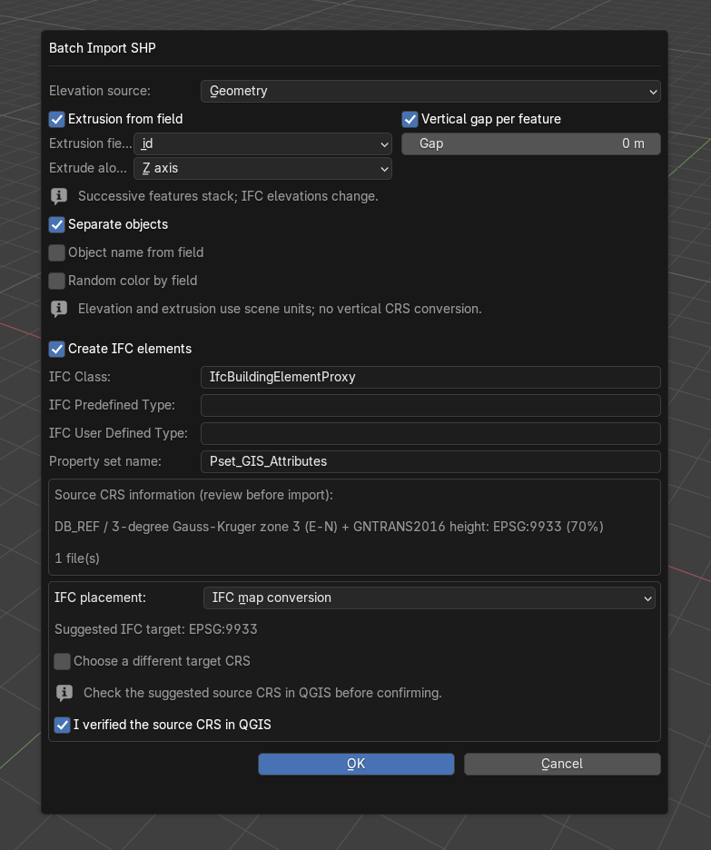

# GIS2BIM

GIS2BIM is a fork of the original [BlenderGIS](https://github.com/domlysz/BlenderGIS) by domlysz, extended with **IFC (Industry Foundation Classes)** integration for streamlined GIS-to-BIM workflows.

- **Blender minimum version required:** v2.83
- **Current version:** 2.2.14

> **Note:** Since 2022, the OpenTopography web service requires an API key. Please register at [opentopography.org](https://opentopography.org) and request a key. This service is still free.

> **Note:** A [MapTiler API key](https://cloud.maptiler.com/) is required for searching and adding Coordinate Reference Systems (CRS) through the EPSG database. Set it in the add-on preferences.

---

## Installation

1. On the [repository page](https://github.com/Kinanqazan/BlenderGIS-IFC), choose **Code → Download ZIP**. Keep the ZIP intact.
2. In Blender, open **Edit → Preferences → Add-ons** and choose **Install from Disk** from the menu in the top right.
3. Select the downloaded ZIP, then enable **GIS2BIM**. The **GIS2BIM** menu appears in the 3D Viewport.

The ZIP must contain the complete repository, including the `core`, `operators`, `clients`, and `icons` directories. The GitHub-generated ZIP can be installed directly. If replacing a previous installation, remove the old copy first and restart Blender to avoid loading the wrong version. For IFC integration, enable Bonsai as described below.

---

## GIS-to-BIM Features

*The shapefile import dialog provides options for geometry, IFC elements, source CRS review, and IFC placement.*

### IFC Class Assignment for Shapefile Import
The biggest addition is seamless **IFC integration** when importing ESRI Shapefiles. This bridges GIS data directly into BIM workflows using [Bonsai](https://bonsaibim.org/) (formerly BlenderBIM).

- **Create IFC elements:** When importing a shapefile, choose the IFC class (e.g., `IfcBuildingElementProxy`). This option is enabled by default.
- **Predefined & User-Defined Types:** Optionally set IFC predefined types and user-defined types.
- **Automatic Property Sets (Psets):** When importing with *"Separate Objects"* enabled, all shapefile attribute fields are automatically mapped to an IFC Property Set on each imported object. Set **Property set name** in the import options to choose its name; the default is `Pset_GIS_Attributes` (also used when the field is blank).
- **Bonsai Integration:** Works directly with Bonsai's API to create proper IFC elements, export mesh geometry as IFC tessellation representations, and update the IFC navigation panel.
- **GIS-only import:** Disable **Create IFC elements** to import without an active IFC project.

See [`IFC_IMPORT_FEATURE.md`](./IFC_IMPORT_FEATURE.md) for detailed usage instructions and workflow examples.

### Color features by attribute
Enable **Separate objects**, then **Random color by field** and choose an attribute. Features with the same value share a color; the same value also receives the same color across imported files. With an active Bonsai IFC project and **Create IFC elements** enabled, the importer creates named IFC surface styles and assigns them to the element geometry. Use Material Preview or material colors in Solid view to see them in Blender. The colors are retained when the IFC is saved.

### Batch Shapefile Import
Import multiple shapefiles in one go via **Shapefile(s) (.shp)** in the GIS2BIM menu. Select one or multiple files in the same dialog. Field-based elevation, extrusion, naming, and coloring use fields shared by all selected files; choose **Separate objects** for naming and coloring. Elevation and extrusion values use scene units; no vertical coordinate transformation is performed.

**Vertical gap per feature** optionally raises successive features by an increasing amount, continuing through the selected files in import order. For example, a gap of 0.01 m adds 0 m, 0.01 m, 0.02 m, and so on to their chosen elevations. This can reduce z-fighting between overlapping surfaces, but alters geometry and exported IFC elevations and can accumulate into a large overall height. The default is zero. Empty records can leave a larger step, and differing original elevations or extrusions can still overlap.

### MapTiler Coordinates API
Migrated CRS search from epsg.io to the [MapTiler Coordinates API](https://cloud.maptiler.com/). Requires a free API key configured in preferences.

### Compatibility & Fixes
- The add-on declares Blender 2.83 as its minimum and rejects Blender major versions above 5; individual workflows require compatible Bonsai and dependencies.
- **macOS Apple Silicon (ARM)** support fixes for image I/O.
- **Pillow** deprecation fixes for recent Python versions.
- **pyshp** and reprojection engine updates.

---

## Functionalities Overview

### GIS Datafile Import
Import in Blender most common GIS data formats: Shapefile vector, raster image, GeoTIFF DEM, OpenStreetMap XML, and ESRI ASCII Grid.

### Grab Geodata Directly from the Web
Display dynamic web maps inside Blender's 3D view, request OpenStreetMap data (buildings, roads, etc.), and get true elevation data from the NASA SRTM mission.

### Additional GIS tools
The menu also offers georeferenced raster, OpenStreetMap, and ASCII grid import,
as well as web geodata and shapefile export. IFC element creation is currently
available through the shapefile importer; the other import tools do not directly
create IFC elements. The inherited camera, object, mesh, and terrain-analysis
operators remain in the add-on but are no longer shown in the main menu.

---

## Requirements for IFC Features

To use the full IFC functionality, install and enable:

- **[Bonsai (BlenderBIM)](https://bonsaibim.org/)** — the free and open-source BIM authoring tool for Blender.
- **IfcOpenShell** — usually bundled with Bonsai; required for Property Set creation.

An active IFC4 project is required for the georeferenced shapefile-to-IFC workflow. For CRS inspection, install PROJ `projinfo` or QGIS; coordinate transformation currently requires a Windows QGIS installation with pyproj. GIS-only imports do not require Bonsai.

The shapefile import dialogs show **Scene georeferencing** on the first import as well as later imports. Choose the shapefile's CRS, and use the scene CRS settings and the **+** beside Origin if you want to enter a projected scene origin before importing. If you leave the origin unset, the first shapefile's bounding-box centre is used automatically. Later imports reuse the scene origin so layers stay aligned; select **Specify shapefile CRS** if a later file uses a different CRS. Changing a scene origin after importing can move existing objects, depending on the georeferencing settings.

To create separate IFC elements with their source attributes, open an IFC4 project in Bonsai and enable **Separate objects**. **Create IFC elements** is on by default. The importer reads the selected files’ `.prj` definitions using PROJ `projinfo` (on PATH or in a Windows QGIS installation). Coordinate transformation uses QGIS Python with pyproj on Windows. It uses the existing IFC CRS or suggests a target when the files share one projected CRS candidate. A fresh project with mixed or geographic inputs needs a projected metre-based target EPSG code. Verify suggested source matches in QGIS when identification is uncertain. Confirm coordinate conversion when a source and target differ. If the source CRS cannot be identified, verify and re-export the layer in QGIS.

The importer sets the IFC map conversion from the shared local origin and keeps that origin for later imports. Save the IFC in Bonsai to carry the projected CRS and map conversion to other viewers. The World Coordinate System can stay at identity because map placement is stored in the map conversion. For georeferenced 2D layers, elevation and extrusion can be taken from fields or an existing mesh, but the importer does not transform vertical datums or infer real-world heights. Before federating models, compare a known point in the saved IFC with the GIS source and check placement in your viewer.

Choose **IFC placement** on the first import into a fresh IFC4 project. **IFC map conversion** is the default. **Direct Site placement** writes the projected easting and northing into the Site placement for viewers that display those coordinates directly. Bonsai keeps the working geometry near the Blender origin. The direct IFC carries no map conversion or projected CRS declaration. You can add more layers to the active project using the same mode. To continue after restarting Blender, save and reopen the Blender scene as well as the IFC; reopening only the IFC in a fresh scene does not restore the required placement state. Start a fresh IFC4 project to use a different mode.

If Bonsai's selected hybrid geometry kernel cannot load, the importer checks OpenCASCADE and switches Bonsai's project geometry setting to it when available. If neither kernel can be initialized, the import stops before IFC assignment. If an IFC assignment otherwise fails, check the logs and undo the import before retrying because the IFC model may have been partially changed.

---

## Links

- [Original BlenderGIS Wiki](https://github.com/domlysz/BlenderGIS/wiki/Home)
- [Original BlenderGIS FAQ](https://github.com/domlysz/BlenderGIS/wiki/FAQ)
- [Original Quick Start Guide](https://github.com/domlysz/BlenderGIS/wiki/Quick-start)
- [Flowchart](https://raw.githubusercontent.com/wiki/domlysz/blenderGIS/flowchart.jpg)
- [IFC Import Feature Documentation](./IFC_IMPORT_FEATURE.md)

## Development and checks

Run the dependency-light tests from the repository root with `python -m unittest discover -s tests -p "test_*.py" -v`. The coordinate worker tests require pyproj; without it they are skipped. The `tests/blender_*.py` scripts exercise Blender and, where indicated, Bonsai/IfcOpenShell. Some integration scripts require local GIS example data in `test-data/Examples GIS/`; this folder is excluded from Git.
